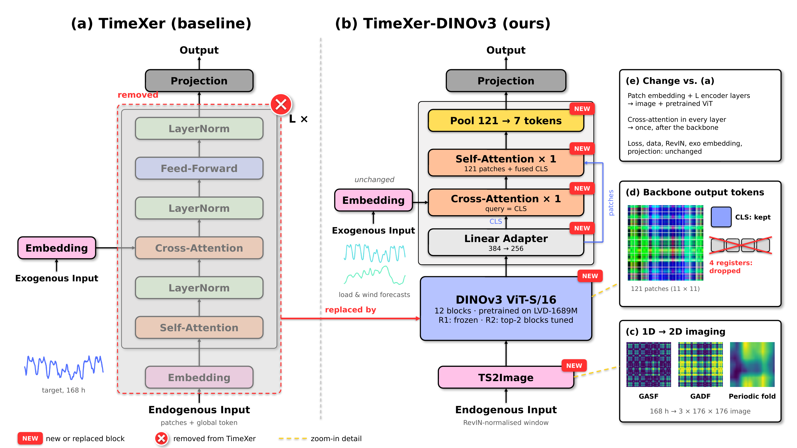

# TimeXer-DINOv3: Can a Pretrained Vision Backbone Replace TimeXer's Endogenous Encoder?

A study built on [TimeXer](https://arxiv.org/abs/2402.19072) (NeurIPS 2024) for electricity price forecasting with exogenous variables. We (1) reproduce TimeXer on the EPF benchmark, then (2) replace its endogenous Transformer encoder with a pretrained **DINOv3** vision backbone applied to an image encoding of the target series, and measure whether this helps.

> **TL;DR — negative result.** TimeXer-DINOv3 is **worse than TimeXer on all 5 EPF markets** (avg. MSE **+9.4%** with partial fine-tuning, **+12.6%** with a frozen backbone), while using 8× more parameters. A linear probe shows that the *pretrained* DINOv3 features keep **less** information about the series than *randomly initialised* ones. Details in [Results](#5-results) and [Why it does not work](#6-why-it-does-not-work).

**Contents:** [1. Highlights](#1-highlights) · [2. Background: TimeXer](#2-background-timexer-baseline) · [3. What we changed](#3-what-we-changed-timexer-dinov3) · [4. Training objective](#4-training-objective-and-protocol) · [5. Results](#5-results) · [6. Analysis](#6-why-it-does-not-work) · [7. Reproduce](#7-reproducing-the-results) · [8. Repository structure](#8-repository-structure) · [9. Limitations](#9-limitations-and-future-work) · [Acknowledgement](#acknowledgement) · [Citation](#citation)

---

## 1. Highlights

- **Faithful reproduction of TimeXer.** 14 of 17 reported cells are within tolerance (EPF avg. MSE 0.312 vs. 0.307 in the paper, 3 seeds). See [`docs/results/G1-reproduction.md`](docs/results/G1-reproduction.md).
- **TimeXer-DINOv3.** The target series is converted to a 3-channel image (GASF, GADF, periodic folding) and encoded by DINOv3 ViT-S/16; covariates keep TimeXer's variate tokens and are fused by cross-attention after the backbone.
- **Controlled comparison.** Same data split, loss, metrics, look-back, horizon, batch size and seed as the baseline; only the endogenous encoder and the fusion step change.
- **Negative result with a diagnosis.** A feature probe attributes the gap to the pretraining objective of DINO and to a token-pooling step, not to undertraining.

## 2. Background: TimeXer (baseline)

TimeXer forecasts one **target** series (the last column, `OT`) from its own history and from **covariates**. The target is split into non-overlapping patches plus a learnable global token; each covariate is embedded as one variate token. In every encoder layer, patch tokens and the global token attend to each other (self-attention), and the global token alone attends to the covariate tokens (cross-attention).

<p align="center">

<br><em>Figure 1. TimeXer architecture, reproduced from the original paper.</em>
</p>

## 3. What we changed: TimeXer-DINOv3

### 3.1 Before vs. after

<p align="center">

<br><em>Figure 2. (a) TimeXer: the faded region marked ✕ (patch embedding and the L encoder layers) is removed. (b) TimeXer-DINOv3: the red arrow shows what replaces it; blocks tagged NEW are added or replaced, while the exogenous embedding and the projection are unchanged. (c) The three image channels of a real NP window. (d) Tokens kept from the backbone. (e) Summary of the change. Source: <a href="./figures/TimeXer_DINOv3_before_after.pptx"><code>figures/TimeXer_DINOv3_before_after.pptx</code></a>, generated by <code>figures/src/</code>.</em>
</p>

### 3.2 Component-level diff

| Component | TimeXer (before) | TimeXer-DINOv3 (after) | Code |
|---|---|---|---|
| Normalisation | RevIN on every channel | unchanged | `models/TimeXer_DINOv3.py` |
| Target tokenisation | 7 linear patch tokens (P = 24) + learnable global token | Target window → 3-channel 176×176 image → 121 ViT patch tokens + CLS | `layers/TS2Image.py` |
| Target encoder | `e_layers` (1–3) Transformer layers, trained from scratch | DINOv3 ViT-S/16, 21.6M params, pretrained on LVD-1689M; Regime 1 frozen, Regime 2 last 2 blocks + all LayerNorms trainable | `models/TimeXer_DINOv3.py` |
| Covariate embedding | Inverted (one token per covariate + time features) | unchanged | `layers/Embed.py` |
| Target–covariate fusion | Cross-attention global → covariates **inside every layer** | Cross-attention CLS → covariates **once, after the backbone**, then 1 self-attention layer | `models/TimeXer_DINOv3.py` |
| Head | Flatten (7+1) tokens → linear | Pool 121 patch tokens → 7, flatten (7+1) tokens → linear | `models/TimeXer_DINOv3.py` |
| Future-known covariates (`x_dec`) | ignored | ignored | — |

### 3.3 Image encoding of the target (`layers/TS2Image.py`)

The normalised window $x \in \mathbb{R}^{L}$ is min-max scaled to $\tilde{x} \in [-1, 1]$ and mapped to angles $\phi_t = \arccos \tilde{x}_t$ (computed without `arccos`, using $\sin\phi_t = \sqrt{1-\tilde{x}_t^2}$):

| Channel | Definition | Captures |
|---|---|---|
| GASF | $\cos(\phi_i + \phi_j)$ | pairwise co-movement (symmetric) |
| GADF | $\sin(\phi_i - \phi_j)$ | pairwise ordering (skew-symmetric) |
| Periodic fold | $\tilde{x}$ reshaped to 7 days × 24 h, bilinearly resized to $L \times L$ | daily and weekly pattern |

The 168×168 stack is resized to 176×176 (11×11 patches of 16 px) and normalised with ImageNet mean/std.

## 4. Training objective and protocol

**The loss function is not changed**, so that any difference comes from the architecture. Both models minimise the mean squared error on the target channel over the forecast horizon:

$$
\mathcal{L} = \frac{1}{B\,H}\sum_{b=1}^{B}\sum_{t=1}^{H}\left(\hat{y}_{b,t} - y_{b,t}\right)^2, \qquad H = 24
$$

- $y$ is the target after **global standardisation** (mean/std fitted on the training split). The model works on RevIN-normalised windows internally and de-normalises its output before the loss.
- Only the target channel is supervised (`features = MS`, `f_dim = -1` in `exp/exp_long_term_forecasting.py`).
- **Evaluation:** MSE and MAE on the standardised test split, without inverse transform, same as the TimeXer paper.

| Setting | TimeXer | TimeXer-DINOv3 |
|---|---|---|
| Split (train/val/test) | 70 / 10 / 20, chronological | same |
| Look-back / horizon | 168 h / 24 h | same |
| Optimiser | Adam, lr 1e-4 | AdamW (weight decay 1e-2); lr 1e-4 for new modules, 1e-5 for DINOv3 |
| LR schedule | halved every epoch (`lradj = type1`) | same, applied to both parameter groups |
| Epochs / early stopping | ≤ 10, patience 3 on validation MSE | same |
| Batch size | 4 (NP, DE), 16 (PJM, BE, FR) | same |
| `d_model` / `d_ff` | 512 / 512 | 256 / 512 |
| Encoder depth | `e_layers` = 3 (NP, PJM), 2 (BE, FR), 1 (DE) | 12 ViT blocks + 1 post-fusion layer |
| Mixed precision | no | yes (`--use_amp`) |
| Seeds | 2021, 2022, 2023 | 2021 |

## 5. Results

### 5.1 Datasets

EPF: day-ahead electricity prices, hourly, about 6 years per market, 2 future-known covariates each.

| Market | Covariates | Period |
|---|---|---|
| NP (Nord Pool) | grid load forecast, wind power forecast | 2013–2018 |
| PJM (US) | system load forecast, COMED zonal load forecast | 2013–2018 |
| BE (Belgium) | generation forecast, system load forecast | 2011–2016 |
| FR (France) | generation forecast, system load forecast | 2011–2016 |
| DE (Germany) | wind power forecast, Amprion zonal load forecast | 2012–2017 |

### 5.2 Reproduction of TimeXer

Tolerance (fixed before running, [ADR-0004](docs/adr/0004-reproduction-acceptance.md)): $|\mathrm{MSE}_{ours} - \mathrm{MSE}_{paper}| \le \max(2\,\sigma_{paper},\ 3\%)$.

| Market | Paper MSE / MAE | Ours, mean ± std over 3 seeds (MSE / MAE) | Δ MSE |
|---|---|---|---|
| NP | 0.236 / 0.268 | 0.241 ± 0.004 / 0.268 ± 0.001 | +2.0% |
| PJM | 0.093 / 0.192 | 0.096 ± 0.002 / 0.194 ± 0.001 | +3.3% (borderline) |
| BE | 0.379 / 0.243 | 0.380 ± 0.003 / 0.242 ± 0.000 | +0.4% |
| FR | 0.385 / 0.208 | 0.395 ± 0.004 / 0.209 ± 0.002 | +2.6% |
| DE | 0.440 / 0.415 | 0.447 ± 0.017 / 0.417 ± 0.004 | +1.6% |
| **AVG** | **0.307 / 0.265** | **0.312 / 0.266** | **+1.6%** |

Long-term exogenous setting (avg. of 4 horizons, MSE): ETTm1 0.052 vs. 0.052, Weather 0.0017 vs. 0.002, ETTh1 0.077 vs. 0.073 (largest gap at horizon 720: +12.8%). Overall, **14 of 17 cells pass**. Full per-cell table: [`docs/results/G1-reproduction.md`](docs/results/G1-reproduction.md).

### 5.3 TimeXer-DINOv3 vs. TimeXer

Same seed (2021) for all columns. Δ is relative MSE change vs. TimeXer; **positive = worse**.

| Market | TimeXer | DINOv3 Regime 1 (frozen) | Δ | DINOv3 Regime 2 (partial FT) | Δ |
|---|---|---|---|---|---|
| NP | **0.237** / **0.267** | 0.271 / 0.296 | +14.6% | 0.252 / 0.288 | +6.6% |
| PJM | **0.097** / **0.195** | 0.132 / 0.223 | +36.1% | 0.119 / 0.213 | +22.8% |
| BE | **0.379** / **0.242** | 0.415 / 0.265 | +9.5% | 0.413 / 0.260 | +8.7% |
| FR | **0.391** / **0.211** | 0.457 / 0.233 | +17.0% | 0.448 / 0.225 | +14.6% |
| DE | **0.466** / **0.421** | 0.492 / 0.448 | +5.5% | 0.485 / 0.441 | +4.1% |
| **AVG** | **0.314** / **0.267** | 0.354 / 0.293 | **+12.6%** | 0.343 / 0.285 | **+9.4%** |

| Cost | TimeXer | DINOv3 Regime 1 | DINOv3 Regime 2 |
|---|---|---|---|
| Total parameters | 2.8M (DE) – 8.1M (NP) | 22.9M | 22.9M |
| Trainable parameters | 2.8M – 8.1M | 1.3M | 4.9M |

The gap is far larger than seed noise (TimeXer std ≤ 0.017 MSE), so the conclusion holds even with one seed for DINOv3. Partial fine-tuning recovers only about 3% of the 13% gap.

## 6. Why it does not work

**Feature probe.** We freeze the image encoder + backbone, extract features for windows of NP (target only), and fit a ridge regression to (a) forecast the next 24 h and (b) reconstruct the last 24 h of the *input*. MSE is in RevIN space and only comparable within this table. Script: [`docs/brainstorm/probes/dinov3_feature_probe.py`](docs/brainstorm/probes/dinov3_feature_probe.py) (about 3 minutes, no training).

| Features fed to ridge | Forecast MSE ↓ | Input reconstruction R² ↑ |
|---|---|---|
| Seasonal naive (repeat last day) | 1.190 | — |
| Raw window (168 values) | **1.141** | 1.000 |
| DINOv3 **pretrained**, pooled 7 + CLS (as in the model) | 1.559 | 0.555 |
| DINOv3 pretrained, all 121 patches + CLS | 1.406 | 0.771 |
| DINOv3 **random init**, pooled 7 + CLS | 1.319 | 0.840 |
| DINOv3 random init, all 121 patches + CLS | 1.141 | 0.919 |

**Findings:**

1. **The pretraining objective works against forecasting.** DINO is trained to be invariant to crops, flips and colour jitter. In GASF/GADF images, values are encoded as pixel intensity and a flip reverses time. Pretrained features are worse than random ones on both tasks.
2. **Raster-order pooling discards information.** Pooling 121 → 7 tokens averages along the row-major order of the 11×11 grid, so each group spans about 1.5 image rows and matches no time interval. Reconstruction R² drops from 0.77 to 0.56.
3. **The image adds no information.** At best (random init, no pooling) the features only match the raw window, at the cost of 30k pixels and 21.6M parameters.
4. **No direct path from the target to the head**, unlike TimeXer's linear patch embedding.
5. **Shallower fusion.** Covariates are fused once after the backbone instead of in every layer.

Full write-up: [`docs/results/DINOv3-negative-result.md`](docs/results/DINOv3-negative-result.md).

## 7. Reproducing the results

### 7.1 Environment

Tested with Python 3.10.12, PyTorch 2.5.1 + CUDA 12.1, timm 1.0.30, on one NVIDIA RTX 2050 (4 GB).

```bash
git clone https://github.com/vminh16/TimeXer.git && cd TimeXer
python -m venv .venv && source .venv/bin/activate
pip install torch==2.5.1 --index-url https://download.pytorch.org/whl/cu121
pip install -r requirements.txt
```

### 7.2 Data

The EPF datasets are included in `dataset/EPF/`. For ETT, Weather, ECL and Traffic, download the archive from the upstream TimeXer links ([Google Drive](https://drive.google.com/drive/folders/13Cg1KYOlzM5C7K8gK8NfC-F3EYxkM3D2?usp=sharing) / [Baidu Drive](https://pan.baidu.com/s/1r3KhGd0Q9PJIUZdfEYoymg?pwd=i9iy)) into `dataset/`. On Windows, `scripts/prepare_datasets.ps1` extracts `dataset/all_datasets.zip`.

### 7.3 Pretrained weights

`timm` downloads `timm/vit_small_patch16_dinov3.lvd1689m` from the Hugging Face Hub on first use (≈ 86 MB, cached in `~/.cache/huggingface`). No access request is needed, unlike the official `facebook/dinov3-*` repositories. The weights are released under the [DINOv3 License](https://github.com/facebookresearch/dinov3/blob/main/LICENSE.md).

### 7.4 Run

```bash
# Sanity checks (shapes, NaNs, GASF symmetry, register-token removal, gradient isolation)
python test_ts2image.py
python test_timexer_dinov3.py

# Baseline: TimeXer on all 5 EPF markets (seed 2021, the run.py default)
bash scripts/forecast_exogenous/EPF/TimeXer.sh
# 3-seed reproduction (Windows, seeds 2021–2023): scripts/forecast_exogenous/EPF/TimeXer.ps1

# TimeXer-DINOv3: Regime 1 (frozen) and Regime 2 (partial fine-tuning)
bash scripts/forecast_exogenous/EPF/TimeXer_DINOv3.sh regime1 2021
bash scripts/forecast_exogenous/EPF/TimeXer_DINOv3.sh regime2 2021

# Feature probe from Section 6
python docs/brainstorm/probes/dinov3_feature_probe.py
```

Windows users: each `.sh` script has a `.ps1` counterpart in the same folder.

Metrics are appended to `result_long_term_forecast.txt`; predictions and per-run metrics are saved under `results/<setting>/`. On an RTX 2050, one EPF market takes roughly 20 min (Regime 1) and 30–50 min (Regime 2).

## 8. Repository structure

Only files added or modified relative to upstream TimeXer are listed.

```
├── layers/TS2Image.py                  # target window → 3-channel image (new)
├── models/TimeXer_DINOv3.py            # proposed model (new)
├── models/RLinear.py                   # extra baseline (new)
├── exp/exp_long_term_forecasting.py    # AdamW with separate lr for the backbone
├── run.py                              # --seed is now honoured; DINOv3 arguments
├── scripts/forecast_exogenous/EPF/TimeXer_DINOv3.sh
├── test_ts2image.py, test_timexer_dinov3.py
├── figures/TimeXer_DINOv3_before_after.{pptx,png}   # Figure 2
├── figures/src/                         # scripts that regenerate Figure 2
└── docs/
    ├── experiments/EXPERIMENT_SPEC_DINOV3_TIMEXER.md   # full design spec
    ├── results/                         # reproduction report, negative result, raw CSV
    ├── adr/                             # decisions: acceptance criteria, baselines, scope
    └── brainstorm/probes/               # analysis scripts
```

<details>
<summary>DINOv3 command-line arguments</summary>

| Argument | Default | Description |
|---|---|---|
| `--dino_model_name` | `vit_small_patch16_dinov3` | timm model name |
| `--dino_img_size` | `176` | image side, multiple of 16 |
| `--dino_freeze` | `all` | `all` (Regime 1), `partial` (Regime 2), `lora` (untested), `none` |
| `--dino_lr` | `1e-5` | learning rate for backbone parameters |
| `--period_len` | `24` | period of the folding channel |
| `--use_pooled_bottleneck` | `1` | pool 121 patch tokens to `seq_len / patch_len` before the head |
| `--post_e_layers` | `1` | self-attention layers after fusion |

</details>

## 9. Limitations and future work

- DINOv3 results use one seed; TimeXer uses three.
- `d_model` differs (256 vs. 512) because of the 4 GB GPU.
- Neither model uses future-known covariates (`x_dec`), although EPF provides them.
- The LoRA regime is implemented but not evaluated.
- Next steps if the vision direction is revisited: a reconstruction-pretrained backbone (MAE, as in VisionTS), a residual design that keeps TimeXer's 1D encoder, pooling along image axes instead of raster order, and caching frozen features to cut training time.

## Acknowledgement

This repository is a fork of [thuml/TimeXer](https://github.com/thuml/TimeXer) and builds on [Time-Series-Library](https://github.com/thuml/Time-Series-Library). Pretrained weights come from [DINOv3](https://github.com/facebookresearch/dinov3) via [timm](https://github.com/huggingface/pytorch-image-models). EPF data are from the TimeXer release.

## License

Code inherited from TimeXer follows the upstream repository's license. DINOv3 weights are subject to the DINOv3 License.

## Citation

If you use this code, please cite the original works:

```bibtex
@article{wang2024timexer,
  title   = {TimeXer: Empowering Transformers for Time Series Forecasting with Exogenous Variables},
  author  = {Wang, Yuxuan and Wu, Haixu and Dong, Jiaxiang and Liu, Yong and Qiu, Yunzhong and Zhang, Haoran and Wang, Jianmin and Long, Mingsheng},
  journal = {Advances in Neural Information Processing Systems},
  year    = {2024}
}

@misc{simeoni2025dinov3,
  title         = {{DINOv3}},
  author        = {Sim{\'e}oni, Oriane and others},
  year          = {2025},
  eprint        = {2508.10104},
  archivePrefix = {arXiv}
}
```
